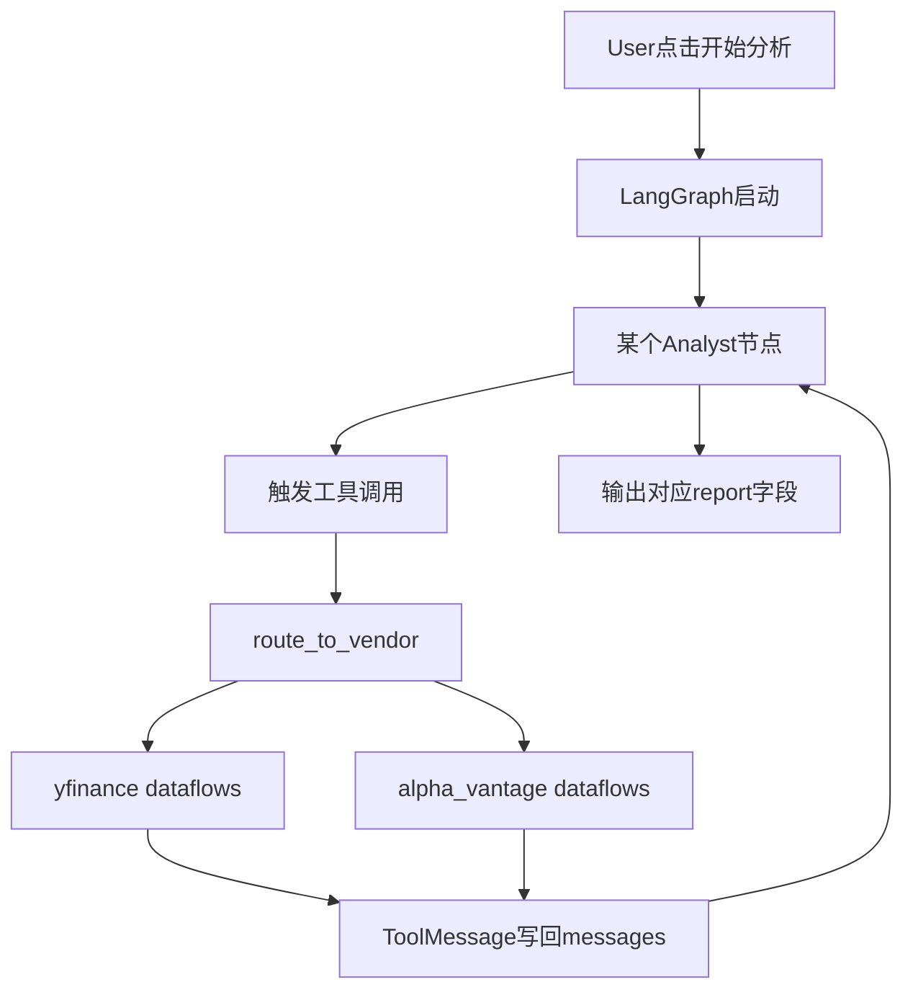

# TradingAgents 数据获取说明（产品文档风格）

## 文档目的

本文面向产品与前端协作，解释 TradingAgents 在一次分析任务中如何完成数据获取与报告生成，重点覆盖四个 Analyst：

- Market Analyst
- Social Media Analyst
- News Analyst
- Fundamentals Analyst

---

## 1. 产品级结论

在当前架构中：

- Analyst 负责“决定要查什么数据、如何写结论”；
- 工具层负责“把请求路由到具体数据源”；
- Dataflows 负责“真正请求外部数据并返回结果”；
- 最终结果进入 LLM 上下文，产出对应的报告字段（如 `market_report`）。

默认数据源为 `yfinance`，支持切换/回退到 `alpha_vantage`。

---

## 2. 统一数据流程（全 Analyst 通用）

---

## 3. 四类 Analyst 示例（与 market 同粒度）

## 3.1 Market Analyst 示例

**触发节点**
- `tradingagents/agents/analysts/market_analyst.py`
- 函数：`create_market_analyst()` 内部 `market_analyst_node(state)`

**执行步骤**
1. 绑定工具：`get_stock_data`、`get_indicators`  
2. 调用 `get_stock_data` 时进入：  
   `agents/utils/core_stock_tools.py -> route_to_vendor("get_stock_data") -> dataflows/y_finance.py:get_YFin_data_online`  
3. 获取价格数据（OHLCV）后，再调用 `get_indicators` 生成技术指标序列。  
4. 工具结果通过 ToolMessage 回写 `messages`，LLM整合后输出 `market_report`。

**典型数据**
- 价格：Date/Open/High/Low/Close/Adj Close/Volume
- 指标：RSI、MACD、SMA、EMA、BBANDS、ATR 等

**输出形态**
- 以字符串为主（Header + CSV / 日期值列表）

---

## 3.2 Social Media Analyst 示例

**触发节点**
- `tradingagents/agents/analysts/social_media_analyst.py`
- 函数：`create_social_media_analyst()` 内部 `social_media_analyst_node(state)`

**执行步骤**
1. 绑定工具：`get_news`（当前只有这一项）。  
2. 调用链路：  
   `agents/utils/news_data_tools.py -> route_to_vendor("get_news") -> dataflows/yfinance_news.py:get_news_yfinance`  
3. 拉取指定时间范围内、与标的相关的新闻内容（标题/摘要/来源/链接）。  
4. 工具结果回写 `messages`，LLM 汇总形成 `sentiment_report`。

**典型数据**
- 公司相关新闻与舆情近似信息（不是直接社媒 API）

**输出形态**
- Markdown 新闻段落文本（分条目）

---

## 3.3 News Analyst 示例

**触发节点**
- `tradingagents/agents/analysts/news_analyst.py`
- 函数：`create_news_analyst()` 内部 `news_analyst_node(state)`

**执行步骤**
1. 绑定工具：`get_news`、`get_global_news`（图中也支持 `get_insider_transactions`）。  
2. 调用链路：  
   - 个股新闻：`news_data_tools.py -> route_to_vendor("get_news") -> yfinance_news.py:get_news_yfinance`  
   - 宏观新闻：`news_data_tools.py -> route_to_vendor("get_global_news") -> yfinance_news.py:get_global_news_yfinance`  
3. 获取“个股 + 宏观”双通道新闻后回写 `messages`。  
4. LLM 输出 `news_report`（用于研究与交易判断）。

**典型数据**
- 个股相关新闻
- 宏观经济/市场主题新闻（政策、利率、通胀、市场风险偏好等）

**输出形态**
- Markdown 段落文本（标题、来源、摘要、链接）

---

## 3.4 Fundamentals Analyst 示例

**触发节点**
- `tradingagents/agents/analysts/fundamentals_analyst.py`
- 函数：`create_fundamentals_analyst()` 内部 `fundamentals_analyst_node(state)`

**执行步骤**
1. 绑定工具：`get_fundamentals`、`get_balance_sheet`、`get_cashflow`、`get_income_statement`。  
2. 调用链路：  
   `agents/utils/fundamental_data_tools.py -> route_to_vendor("get_*") -> dataflows/y_finance.py`  
3. 获取公司概览指标 + 三大报表数据。  
4. 工具结果回写 `messages`，LLM 输出 `fundamentals_report`。

**典型数据**
- 估值与质量指标（PE、PB、利润率、ROE、负债等）
- 资产负债表 / 现金流量表 / 利润表（按季度或年度）

**输出形态**
- 概览为多行文本，报表为 Header + CSV

---

## 4. 数据如何进入 Prompt（产品视角）

每个 Analyst 都使用同一机制：

1. 读取初始任务上下文：`company_of_interest`、`trade_date`、历史 `messages`。  
2. 通过 prompt 模板（含 `MessagesPlaceholder("messages")`）读取所有历史消息。  
3. 工具输出以 ToolMessage 形式回写 `messages`。  
4. Analyst 在下一轮推理中自动“看到最新数据”。  
5. 当不再调用工具时，输出本角色报告到对应字段。

这意味着：  
**数据进入模型的主要方式是“消息上下文注入”，而不是单独拼接一个大 JSON 变量。**

---

## 5. 当前数据结构现状（给前端）

默认 yfinance 路径下，工具返回以 `str` 为主，常见三类：

1. Header + CSV（价格、财务报表）  
2. 日期值列表 + 指标说明（技术指标）  
3. Markdown 新闻段落（新闻/宏观）

这对“生成文本报告”很高效；  
但对“前端直接图表化”不够直接，后续建议增加结构化输出层（JSON schema）。

