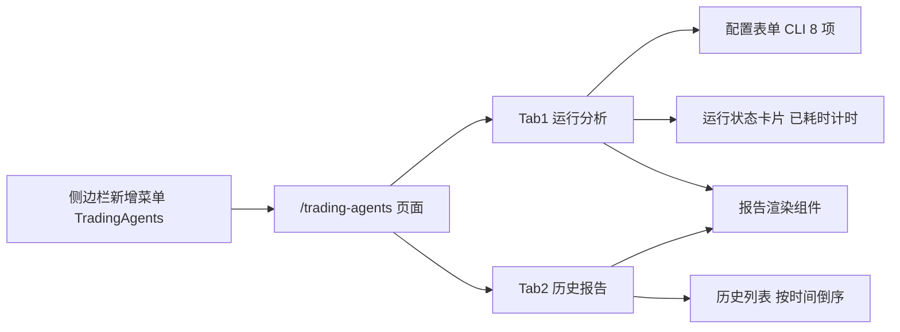

# TradingAgents 接入前端 · 产品需求文档 (v1.0)

> 关联功能：`/trading-agents` 页面与 `cli/main.py` 的 Web 化封装
> 起始日期：2026-05-13

## 1. 背景与目标

仓库根目录 `cli/main.py` 已实现完整的 TradingAgents 多 Agent 分析流水线（Analyst → Research → Trader → Risk → Portfolio），但只能在终端运行；分析产物虽然落盘到 `reports/{ticker}_{timestamp}/`，却无法在 Web UI 中浏览。

本期目标：

- 将 CLI 流程包装成无交互的后端服务，在 Web UI 上提供「配置 → 触发 → 查看报告」的完整闭环。
- 报告渲染结构化、可读性高，整体视觉风格延续 dashboard / stock-detail 的暗色卡片体系。
- 历史报告（本地 `reports/` 目录）可在子 Tab 中检索回看。

非目标：

- 不做实时进度推送（不引入 SSE / WebSocket）。第一期采用「最简模式」：后台 background task + 前端 2-3 秒轮询 job 状态，完成后一次性渲染。
- 不做权限控制、不做多用户隔离、不做 reports 的远端同步。

## 2. 核心用户故事

- US1：作为研究员，我想在「TradingAgents」菜单里像在 CLI 一样配置 ticker / 日期 / 分析师团队 / 研究深度 / LLM Provider / Quick & Deep 模型，一键启动分析。
- US2：在分析运行的几分钟里，页面始终明确告诉我「正在运行 · 已耗时 mm:ss」，不会让我以为页面卡死。
- US3：分析跑完后，页面下方按 I-V 五段直接展示完整结构化报告（与 stock-detail 一致的折叠卡片风格），并在顶部高亮显示最终决策（BUY/HOLD/SELL）。
- US4：通过子 Tab「历史报告」可以查看本地 `reports/` 目录中所有过往报告，点击列表项即可在右侧渲染同样的结构化视图。

## 3. 选项与默认值（与 CLI 1:1）

完整暴露 CLI 现有 8 项配置（数据源：`cli/utils.py` 与 `tradingagents/llm_clients/model_catalog.py`）：

| 选项 | 类型 | 默认值 | 说明 |
| ---- | ---- | ------ | ---- |
| Ticker | 文本 | 必填 | 大写归一化，例如 NVDA、CNC.TO、7203.T |
| Analysis Date | 日期 | 今日 | YYYY-MM-DD，不允许未来日期 |
| Output Language | 下拉 | English | English / Chinese / Japanese / Korean / Hindi / Spanish / Portuguese / French / German / Arabic / Russian / Custom |
| Analysts Team | 多选 Checkbox | 全选 | Market / Social / News / Fundamentals |
| Research Depth | 单选 | Medium = 3 | Shallow = 1 / Medium = 3 / Deep = 5 |
| LLM Provider | 下拉 | SiliconFlow | OpenAI / SiliconFlow / Google / Anthropic / xAI / Openrouter / Ollama |
| Quick / Deep Model | 下拉 | 各 Provider 第一项 | 依据 Provider 动态加载选项 |
| Provider-specific 思考配置 | 下拉 | medium / high | OpenAI 与 SiliconFlow 用 reasoning_effort；Anthropic 用 effort；Google 用 thinking_level；其他 Provider 不显示 |

## 4. 信息架构



报告渲染组件在两个 Tab 之间共用，保证视觉与交互一致。

## 5. 后端设计

### 5.1 新服务 `web/services/trading_agents_service.py`

把 `cli/main.py` 中 `run_analysis()` 内嵌的 `typer.prompt` 全部拆掉，提取出以下函数：

- `get_options()`：返回 Provider / quick & deep model / analysts / depth / language 等选项数据。
- `run_analysis_job(config: dict) -> dict`：接收来自 API 的 JSON 配置，构造 `TradingAgentsGraph` 并 `graph.stream(...)`，写盘到 `reports/{ticker}_{timestamp}/`，返回 `report_id`。
- `list_reports() -> list[ReportMeta]`：扫描 `reports/`，每个目录解析出 `{report_id, ticker, generated_at, analysts, has_complete_report}`。
- `get_report(report_id: str) -> ReportDetail`：读取 `complete_report.md` 与 `1_analysts/ 2_research/ 3_trading/ 4_risk/ 5_portfolio/` 五个子目录，组装成结构化 JSON。

复用 `cli/main.py` 中已经写好的 `save_report_to_disk()`（第 638 行起）作为落盘函数。

Job 状态管理沿用 stock_tracker_service 的 in-memory dict 方案：

- `JOBS: dict[str, TaJob]`，含 `status / started_at / completed_at / error / report_id` 等字段。
- 用 `threading.Thread` 守护线程启动；前端轮询 `/jobs/{job_id}` 直到 `status` 变为 `completed` 或 `failed`。

### 5.2 API 路由（挂载到 `backend/api/main.py`）

- `GET /api/v1/trading-agents/options`：一次性返回 Provider 列表、各 Provider 的 quick/deep model 选项、analysts、depth、language 选项。前端进页面时拉一次。
- `POST /api/v1/trading-agents/run`：body 即表单选项；返回 `{job_id}`。
- `GET /api/v1/trading-agents/jobs/{job_id}`：返回 `{status, elapsed_seconds, error?, report_id?}`。
- `GET /api/v1/trading-agents/reports`：返回历史列表。
- `GET /api/v1/trading-agents/reports/{report_id}`：返回单个报告结构化 JSON。

### 5.3 报告结构化 JSON Schema

```ts
type ReportDetail = {
  report_id: string;
  ticker: string;
  generated_at: string;
  decision: "BUY" | "HOLD" | "SELL" | "UNKNOWN";
  decision_summary: string;
  sections: {
    analysts: { market?: string; social?: string; news?: string; fundamentals?: string };
    research: { bull?: string; bear?: string; manager?: string };
    trading: { trader?: string };
    risk: { aggressive?: string; conservative?: string; neutral?: string };
    portfolio: { decision?: string };
  };
};
```

`decision` 用正则从 `final_trade_decision` 中匹配 BUY / HOLD / SELL，匹配不到回退 `UNKNOWN`。

## 6. 前端设计

### 6.1 菜单与路由

- `frontend/src/components/nav-sidebar.tsx` 中 `NAV` 追加一项：`{ href: "/trading-agents", label: "TradingAgents", icon: "psychology" }`。
- 新建路由 `frontend/src/app/trading-agents/page.tsx`。

### 6.2 页面结构

- 顶部 Tab 切换：`运行分析` / `历史报告`。
- 左侧（运行分析）：配置表单卡片，与 stock-detail 一致的暗色边框、12-13px 字号。
- 右侧 / 下方：报告渲染区。
  - 空态：提示「填写左侧选项并点击 Run Analysis」。
  - 运行态：高亮卡片 "Running · 已耗时 mm:ss"，下方灰色骨架占位。
  - 完成态：顶部决策大卡（BUY/HOLD/SELL 着色：绿/灰/红）+ 五段折叠模块卡片（默认展开 I 和 V）。
- 历史报告 Tab：左侧报告列表（ticker · 日期 · 生成时间 · 分析师徽章），右侧点击后渲染同一个 `<ReportView/>` 组件。

### 6.3 共享组件

- `<ReportView report={ReportDetail}/>` 放在 `frontend/src/components/trading-agents/report-view.tsx`，内部用轻量 markdown 渲染器（不引入新依赖，复刻 dashboard 的简单按行展示策略，但额外支持 H2/H3、列表、加粗）。
- `<RunForm/>`、`<JobStatusCard/>`、`<HistoryList/>` 拆分到同目录便于复用。

### 6.4 API 客户端

在 `frontend/src/lib/api.ts` 追加：

- 类型：`TaOptions`, `TaRunPayload`, `TaJob`, `TaReportMeta`, `TaReportDetail`。
- 函数：`getTaOptions()`, `runTradingAgents(payload)`, `getTaJob(jobId)`, `listTaReports()`, `getTaReport(reportId)`。

## 7. 视觉风格

延续 stock-detail / analysis 页面的设计语言：

- 主背景 `#0B0E11`，卡片 `#161A1F` 边框 `#2B2F36`。
- 决策大卡：BUY = `#22c55e` / HOLD = `#a3a3a3` / SELL = `#f87171`，字号 24-28px。
- 章节折叠卡：标题 14px 字重 600，正文 markdown 渲染（h2/h3 字号递减、列表保留 padding）。
- 表单字体 12-13px，与现有页面一致；按钮采用 dashboard 上 Refresh 按钮的样式。

## 8. 工程约束与边界

- `reports/` 目录已经在 `.gitignore` 中。
- 本期不引入新 Python 包；前端不引入新 npm 包（自实现轻量 markdown 渲染）。
- LLM key 从已加载的 `.env` 读取，沿用 `backend/api/main.py` 顶部 `load_dotenv()` 机制。
- 由于运行时间长（分钟级），后端 job 必须放在 background task；HTTP request 立即返回 `job_id`。
- 单实例并发上限：第一期硬编码 1 个运行中 job，新请求若有 job 在跑则返回 409。

## 9. 验收标准

- 左侧表单完整呈现 CLI 8 步选项；选项与 `cli/utils.py` 行为一致。
- 触发 Run 后页面持续显示 "Running · 已耗时 X:XX" 直至完成，无白屏卡死。
- 报告渲染后顶部决策颜色正确，五段全部按 markdown 结构化展示，与 `cli/main.py` 的 `display_complete_report` 内容一致。
- 历史 Tab 列表按 `generated_at` 倒序；点击任一项加载结构化报告。
- 后端 API 五条全部能用 curl 直接调通；落盘的 `reports/{ticker}_{timestamp}/complete_report.md` 与 CLI 跑出来的一致。

## 10. 后续可扩展（不在本期范围）

- 实时进度流（SSE）+ 当前 agent 状态条
- LLM 对 final_trade_decision 二次精炼出结构化 JSON（目标价、止损、仓位、时间窗口）
- 报告对比：同一 ticker 多日报告并排
- 报告导出 PDF / 分享链接
