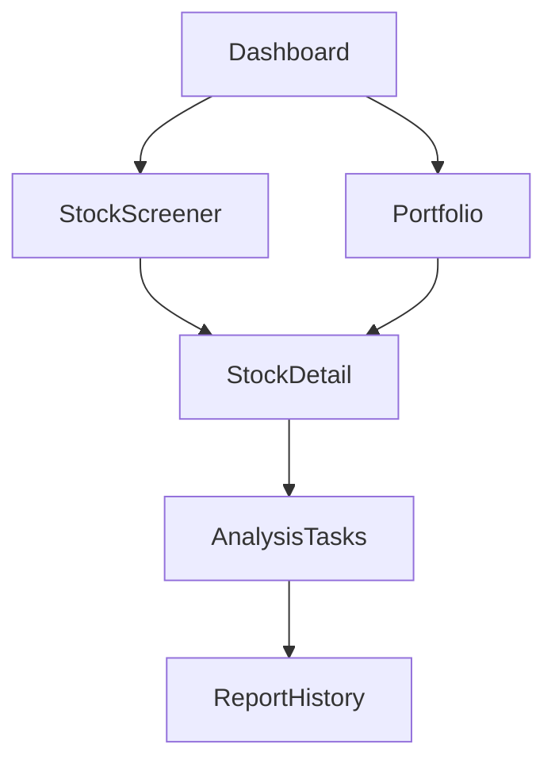

# TradingAgents WebUI PRD（现状对齐版）

> **归档说明（2026-05）**：原 Streamlit WebUI 已从仓库移除；当前产品界面为 **Next.js + FastAPI**。下文保留作历史设计与迁移参考。

## 1. 文档信息

- 文档名称：TradingAgents WebUI 产品需求文档（PRD）
- 文档版本：v1.0（现状对齐）
- 文档状态：**Archived**（原 Streamlit 实现已下线）
- 适用范围：~~当前仓库 `TradingAgents` 的 Streamlit WebUI~~（已移除）

---

## 2. 产品目标与定位

本 WebUI 的核心目标是提供一个可操作的交易研究工作台，覆盖以下闭环：

1. 市场总览（Dashboard）
2. 个股筛选与详情查看
3. 触发分析任务并跟踪过程
4. 浏览历史报告与最新决策摘要
5. 记录与管理个人持仓

当前版本强调“手动触发、可解释、可回看”，而不是自动化交易执行。

---

## 3. 信息架构（当前实现）

一级导航由 `app.py` + `web/pages/__init__.py` 的 `PAGES` 控制，包含 6 个页面：

1. `仪表盘`（Dashboard）
2. `个股分析`（Analysis Tasks）
3. `策略`（Strategy，占位）
4. `股票筛选`（Stock Screener）
5. `股票详情`（Stock Detail）
6. `持仓`（Portfolio）

辅助子页面（非一级导航）：

- `报告历史`：`web/pages/report_history.py`，在“个股分析”和“股票详情”内嵌复用

---

## 4. 全局交互与视觉规范

## 4.1 导航与状态

- 侧栏导航组件：`web/sidebar_nav.py::render_sidebar_navigation()`
- 页面切换状态：`st.session_state.current_page`
- 跨页股票联动状态：`st.session_state.selected_ticker`

## 4.2 主题与布局

- 主题入口：`web/theme.py::apply_theme()`
- 外壳常量：`web/ui_shell.py`
  - `SIDEBAR_WIDTH_PX`（展开态宽度）
  - `COLOR_NAV_RAIL_BASE` / `COLOR_NAV_RAIL_EDGE`
- 侧栏收缩行为：
  - 使用 Streamlit 原生收缩/展开
  - 展开态固定宽度，收缩态宽度归零，主内容区自动适配

## 4.3 会话状态初始化

`app.py::_init_session_state()` 维护全局状态，关键字段包含：

- `current_page`, `ui_mode`, `show_config`
- `selected_ticker`, `last_params`, `runtime_stage`
- `active_output_dir`, `runtime_stats`, `error`

---

## 5. 页面功能规格（当前已实现）

## 5.1 仪表盘（`web/pages/dashboard.py`）

### 目标

提供“今日市场发生了什么”的一屏式概览，支持手动刷新与快照持久化。

### 展示模块

- 数据时间与市场状态（ET 时区）
- 大盘总结（LLM 生成，Markdown）
- 宏观代理指标（美债收益率、DXY、TIP 等）
- 主要指数（SPY / QQQ / DIA / VIX）
- 板块强弱 Top3（ETF 代理）
- Top10 财经新闻（来源、发布时间、立场、LLM 解读、外链）

### 交互

- 按钮：`更新市场数据`
- 触发后执行采集 -> LLM 增强 -> 落盘 -> 页面刷新展示

### 失败降级

- 当 LLM 失败时保留行情与新闻基础数据
- 页面通过 `llm_news_error` / `llm_digest_error` 进行提示，不阻塞主体展示

---

## 5.2 个股分析（`web/pages/analysis_tasks.py`）

### 子视图

1. `运行与进度`
2. `报告历史`

### 已实现能力

- 分析参数配置（侧栏复用配置组件）
- 启动分析任务并展示阶段进度、日志、统计信息
- 展示最新报告摘要（优先最终决策段）
- 历史报告入口复用 `render_report_history()`

---

## 5.3 策略（`web/pages/strategy.py`）

- 当前状态：占位页
- 已实现：信息提示 + 路线图文档入口
- 未实现：策略录入、回测、策略结果管理

---

## 5.4 股票筛选（`web/pages/stock_screener.py`）

### 已实现能力

- 固定股票池列表（MVP）
- 搜索、排序、行情快读（yfinance fast_info）
- 点击“查看”后写入 `selected_ticker` 并跳转至 `股票详情`

---

## 5.5 股票详情（`web/pages/stock_detail.py`）

### Tab 结构

1. `概览`：技术指标与行情摘要
2. `最新分析`：提示并引导至“个股分析”页触发
3. `历史报告`：按 ticker 查看历史 run 报告

### 边界

- 本页不直接执行分析任务
- 分析执行统一在“个股分析”页进行

---

## 5.6 持仓（`web/pages/portfolio.py`）

### 已实现能力

- 手动录入：`ticker / quantity / buy_price`
- 同 ticker 自动合并持仓
- 重算加权平均成本
- 数量 <= 0 时移除持仓
- 本地 JSON 持久化

---

## 6. 数据与存储设计（当前实现）

## 6.1 Dashboard 快照

由 `web/services/dashboard_store.py` 维护：

- `data/dashboard/latest.json`：最新成功快照（展示优先）
- `data/dashboard/history/*.json`：历史归档快照
- `data/cache/market_snapshot.json`：兼容回退缓存

读取优先级（`load_dashboard_display()`）：

1. 先读 `latest.json`
2. 不存在时回退 `market_snapshot.json`

## 6.2 分析报告

- 目录约定：`reports/{ticker}_{YYYYMMDD}`
- 扫描入口：`web/history.py::list_report_runs()`
- 渲染入口：`web/report_viewer.py`

---

## 7. 服务层能力与责任

## 7.1 行情/新闻/宏观（Dashboard）

`web/services/market_data.py`：

- 指数、板块、宏观代理数据拉取
- Top 新闻抓取与清洗
- 统一刷新流程与错误收敛

## 7.2 LLM 增强（Dashboard）

`web/services/dashboard_llm.py`：

- 新闻立场（bullish / bearish / neutral）与简要解读
- 大盘总结 Markdown 生成
- 失败降级与错误字段写入

## 7.3 其他基础服务

- `web/services/time_utils.py`：时间格式与市场状态文案
- `web/services/portfolio_store.py`：持仓读写与合并规则
- `web/services/indicator_service.py`：详情页指标计算封装

---

## 8. 非目标与当前限制

以下内容不属于当前版本已实现范围：

1. 自动定时刷新（当前为手动刷新）
2. 策略模块完整能力（仅占位）
3. 股票详情页内直接运行分析（仅跳转引导）
4. 自动下单与券商执行链路
5. Dashboard 历史快照可视化浏览页面（仅有落盘能力）

---

## 9. 验收标准（现状基线）

1. 首页可通过侧栏进入所有一级页面，且页面渲染无阻塞。
2. Dashboard 点击“更新市场数据”后，可看到最新行情/新闻及更新时间。
3. Dashboard 成功写入 `latest.json`，并在 `history` 目录生成归档文件。
4. 股票筛选可跳转到股票详情并带入 ticker。
5. 个股分析可启动任务并在 UI 中查看运行结果与历史报告。
6. 持仓录入满足合并与平均成本计算逻辑。

---

## 10. 下一步建议（文档外的研发方向）

1. 为 Dashboard 增加“历史快照浏览与对比”页面。
2. 完成策略模块（策略定义、回测、结果归档）。
3. 将持仓与分析结果建立上下文关联（仓位感知建议）。
4. 增加错误监控与数据源健康提示（尤其 yfinance 抖动时）。
# TradingAgents WebUI PRD（可实现版草案）

## 1. 文档信息

- 文档名称：TradingAgents WebUI 产品需求文档（PRD）
- 文档版本：v0.2（可实现版）
- 文档状态：Draft
- 适用阶段：MVP 需求冻结与开发启动

---

## 2. 背景与问题

当前 Web 端以“单次分析报告查看”为主，存在以下问题：

1. 缺少市场总览入口，用户很难先判断“今天看什么”。  
2. 单股页面能力不足，数据仪表盘与分析任务割裂。  
3. 持仓尚未形成产品闭环（只能看报告，不能管理仓位输入）。  

目标是升级为“市场总览 -> 个股分析 -> 报告回看 -> 持仓准备”的可操作工作台。

---

## 3. 产品目标与范围

### 3.1 总体目标

构建面向美股科技交易决策的 WebUI，支持用户完成：

1. 看市场（指数、VIX、重点新闻、板块）  
2. 看个股（仪表盘 + 最新分析 + 历史报告）  
3. 管持仓（手动录入与合并）  

### 3.2 范围边界

- 市场范围：仅美股
- 板块范围：先聚焦纳斯达克科技
- 数据更新：统一手动刷新（本期不做自动轮询）
- 持仓建议：本期先不把持仓注入 TradingAgents prompt（下一阶段）

---

## 4. 核心场景（按你确认的需求）

## 4.1 场景 A：查看市场总览

用户进入 Dashboard 后，应在一个页面看到：

1. 美股三大指数当前点位 + 相比昨日收盘涨跌  
2. VIX 波动指数  
3. 当日最值得关注的 10 条财经新闻  
4. Top3 板块数据（若 yfinance 可得）

## 4.2 场景 B：查看单股并触发分析

用户进入单股页后：

- 主 tab：股票仪表盘（HV、IV、成交量及对比昨日、MA 状态、KDJ、MACD）
- 次 tab：最新分析（手动触发，逻辑沿用当前 run 流程）
- 次 tab：历史分析（调用本地报告文件）

## 4.3 场景 C：录入个人持仓

用户可手动录入：

- 代码（ticker）
- 持有数量（quantity）
- 买入价格（buy_price）

同一代码多次录入时：

- 自动合并数量
- 自动计算平均成本

## 4.4 场景 D：复盘

- 本期不做完整复盘模块，仅保留历史报告检索与查看。

## 4.5 数据更新规则（全局）

所有数据通过“更新按钮”手动刷新；刷新前必须做美东时间校验：

1. 判断当前 ET 时间是否在交易时段（工作日 09:30-16:00）  
2. 页面提示盘中/盘后状态  
3. 所有模块展示统一 `last_updated_et`

---

## 5. 产品信息架构（IA）

采用左侧菜单作为一级导航，二级页面如下：

1. `Dashboard`（市场总览）
2. `Stock Screener`（股票列表）
   - 二级：`Stock Detail`（单股看板，点击 ticker 进入）
3. `Analysis Tasks`（Run/Progress/Logs）
   - 二级：`Report History`（历史报告中心）
4. `Portfolio`（我的持仓）

页面关系：

---

## 6. 功能需求（可实现层）

## 6.1 Dashboard（MVP 必须）

### 展示组件

- 指数卡：SPY / QQQ / DIA 当前值、涨跌额、涨跌幅
- VIX 卡：`^VIX` 当前值、涨跌
- 新闻列表：Top10 财经新闻（按相关性/时间）
- 板块卡：Top3 板块表现（可用 ETF 近似）
- 刷新区：更新按钮 + ET 时间状态 + last_updated_et

### 数据来源建议

- 行情：yfinance
- 新闻：现有 `yfinance_news` 结果
- 板块：优先 ETF proxy（如 XLK/SOXX/QQQ 子集）实现首版

### 验收标准

- 首屏可展示缓存数据
- 点击更新后可完成刷新并更新 ET 时间戳

### 仪表盘数据流与存储（2026 补充）

| 路径 | 用途 |
|------|------|
| `data/dashboard/latest.json` | **优先**：最近一次成功「更新市场数据」的完整快照（指数、宏观条、新闻含 LLM 字段、`market_digest_md`），供冷启动直接展示。 |
| `data/dashboard/history/*.json` | 按 UTC 时间戳归档的历次快照，便于后续批量历史分析；默认 gitignore。 |
| `data/cache/market_snapshot.json` | 兼容旧逻辑；无 `latest.json` 时回退读取。 |

**宏观条（Yahoo）**：美债收益率指数 `^IRX` / `^FVX` / `^TNX` / `^TYX`、美元指数 `DX-Y.NYB`、`TIP` 等；与「主要指数」同为横向卡片，**主标题 / 大数字 / 副标题**三层结构（内联样式 + 优先 `st.html` 渲染，避免 Streamlit 对 HTML class 清洗导致样式丢失）；**非**劳工部 CPI 等官方发布值。

**新闻**：解析 `published_at`；**新闻速览**卡片仅保留「阅读原文」（外链新标签）。**阅读全文**在应用内独立标签页展示标题、摘要、立场与大模型解读，底部 `link_button` 打开媒体原文（因 Yahoo 通常无正文抓取，站内以摘要+外链为准）。

**顶部数据时间**：在页标题下展示「上次手动更新」的 `fetched_at_utc`（UTC + 本地对照），与 `last_updated_et`（行情快照观察时间）区分；二者均来自最近一次成功「更新市场数据」写入的快照字段。

**LLM**（仅手动更新后触发）：复用 `tradingagents.llm_clients.factory.create_llm_client` 与 **quick** 模型；仪表盘**固定**调用 `build_llm_config(None)`（与个股分析表单的 `last_params` **解耦**，避免沿用分析任务里的 OpenAI / gpt-5.4-mini）。默认 **SiliconFlow**（`https://api.siliconflow.cn/v1`）+ `model_catalog` 中 SiliconFlow 的首个 quick 模型，密钥 `SILICONFLOW_API_KEY`。快照字段含 `llm_provider` 与 `llm_model` 便于界面展示。实现位于 `web/services/dashboard_llm.py`（与多智能体分析图独立）。

1. **新闻批量**：一次请求返回 JSON 数组，每条含 `stance`（bullish/bearish/neutral）与 `llm_summary`（展示为「大模型解读」）；失败时写入 `llm_news_error`，界面提示但不阻塞。
2. **大盘总结**：单次调用生成 Markdown，置于仪表盘顶部（经济/盘面/新闻/结论/牛熊与论据）；失败或无内容时占位说明，并可选展示 `llm_digest_error`。

**策略菜单**：当前占位；表单与回测路线图见 [strategy_module_future.md](./strategy_module_future.md)。

## 6.2 Stock Screener + Stock Detail（MVP 必须）

### Stock Screener

- 展示纳斯达克科技股票池（首版可静态配置）
- 支持 ticker 搜索
- 支持按涨跌幅、成交量排序

### Stock Detail

- Tab-1 `Overview`：HV、IV、成交量对比、MA/KDJ/MACD
- Tab-2 `Latest Analysis`：手动触发 TradingAgents 任务（沿用当前逻辑）
- Tab-3 `History Reports`：该 ticker 的历史报告列表与查看

### 指标实现口径（首版）

- `HV`：使用近 20/30 交易日历史波动率（由历史日线收益率年化计算）
- `IV`：若数据源可得（如 options chain），展示近月 ATM IV；若不可得，显示 `N/A`
- `成交量对比昨日`：`(今日成交量 - 昨日成交量) / 昨日成交量`
- `MA 状态`：展示 `MA20/MA50/MA200` 相对当前价格位置
- `KDJ/MACD`：
  - 优先复用现有技术指标能力（`get_indicators` / dataflows）
  - 若某指标当前不可得，显示降级提示并保证页面可用

### 验收标准

- 单股页可在一次导航内完成“看数据 -> 跑分析 -> 看历史”

## 6.3 Analysis Tasks（MVP 必须）

- 保留并复用现有能力：
  - Start New Analysis
  - 12-step 过程进度
  - token 统计
  - 报告产出
- 调整为独立菜单页，提高可读性与可定位性

## 6.4 Report History（MVP 必须）

- 按 `ticker -> date` 重组本地 reports 目录
- 提供可读性更好的选择列表（搜索/筛选）
- 点击后直接渲染对应报告
- 放置于 `Analysis Tasks` 二级页面，避免入口分散

## 6.5 Portfolio（MVP 表单版）

- 提供手动录入表单：ticker/quantity/buy_price
- 实现同 ticker 合并与平均成本计算
- 本期存储方案：本地文件（后续可迁移数据库）
- 先不影响 TradingAgents prompt

---

## 7. 实现方案（技术层）

## 7.1 页面拆分建议

- `app.py`：全局导航、会话状态、公共样式
- `web/pages/dashboard.py`
- `web/pages/stock_screener.py`
- `web/pages/stock_detail.py`
- `web/pages/analysis_tasks.py`
- `web/pages/report_history.py`（作为 analysis_tasks 子视图）
- `web/pages/portfolio.py`

## 7.2 与现有能力复用

- 任务运行：复用 `web/run_pipeline.py`
- 报告渲染：复用 `web/report_viewer.py`
- 历史扫描：复用 `web/history.py`

## 7.3 新增服务层建议

- `web/services/market_data.py`：指数、VIX、板块、新闻聚合
- `web/services/time_utils.py`：ET 时间、交易时段判断
- `web/services/portfolio_store.py`：持仓读写与合并计算
- `web/services/indicator_service.py`：HV/IV/KDJ/MACD 计算与降级封装

## 7.4 数据刷新机制

- 每个页面放置统一“更新按钮”
- 刷新流程：
  1. 校验 ET 时间状态  
  2. 拉取数据  
  3. 更新页面缓存  
  4. 写入 `last_updated_et`

---

## 8. 迭代计划

## 8.1 M1（本期）

- Dashboard 上线
- Stock Screener + Stock Detail 上线
- Analysis Tasks 独立页
- Report History 重构
- Portfolio 表单版上线

## 8.2 M2（下期）

- 持仓注入分析上下文（需要改 TradingAgents prompt/state）
- 输出仓位感知建议（加仓/减仓/观望）

## 8.3 M3（后续）

- 复盘模块（历史建议 vs 市场变化）
- 多板块/多市场扩展

---

## 9. 核心指标（MVP）

- 分析任务成功率
- 报告访问率（任务完成后是否打开报告）
- Dashboard 日活与刷新使用率
- 单股页分析触发率

---

## 10. 风险与待决事项

- Top3 板块数据在 yfinance 的稳定性需验证（必要时用 ETF 近似）
- IV/HV/KDJ 的统一口径与计算来源需先固定
- Social 仍为新闻近似，不等价真实社媒情绪
- 持仓数据存储方式后续需从本地文件升级

---

## 11. 下一步执行清单

1. 冻结 MVP 页面字段（Dashboard/StockDetail/Portfolio/ReportHistory）。  
2. 先完成 ET 时间工具与手动刷新机制。  
3. 打通 Dashboard 数据聚合与渲染。  
4. 完成 Stock Detail 三 tab 与任务复用。  
5. 完成 Portfolio 合并逻辑与本地存储。  

